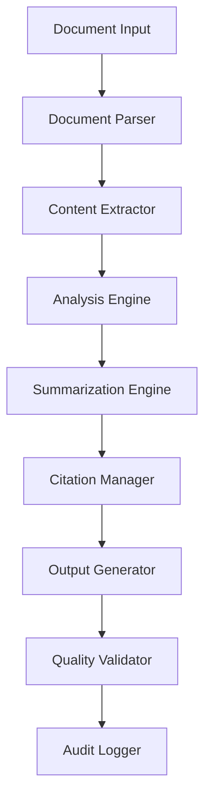

# Clinical Research Documentation Assistant

## Overview
The Clinical Research Documentation Assistant is an AI-powered system designed to improve efficiency and accuracy in healthcare research workflows. It processes publicly available clinical research papers to generate accurate, well-cited summaries tailored for different healthcare audiences (clinicians, researchers, administrators). The system emphasizes accuracy, transparency, and strict compliance with healthcare documentation standards.

## Key Features
- **Research Paper Processing**: Parses PDF research papers, extracting structured content (abstract, methodology, results, conclusions) while ensuring data privacy by rejecting documents with patient data.
- **Content Summarization**: Generates concise, audience-specific summaries (Key Findings, Methodology, Conclusions) with clear distinction between direct quotes and synthesized information.
- **Key Information Extraction**: Automatically extracts primary endpoints, statistical results (p-values, confidence intervals), and methodology details.
- **Citation & Documentation**: Manages academic citations (AMA, APA, Vancouver), maintains bibliographies, and tracks information provenance.
- **Quality Assurance**: Identifies study limitations, detects potential biases, and provides confidence scores for extracted information.
- **Workflow Automation**: Supports batch processing, comparative analysis, and integration with research management systems.

## Architecture
The system follows a modular pipeline architecture:
1.  **Document Ingestion**: Validates and parses input PDFs.
2.  **Content Extraction**: NLP-based extraction of structured data.
3.  **Analysis Engine**: Performs confidence scoring, bias detection, and cross-referencing.
4.  **Summarization Engine**: Generates tailored content for specific audiences.
5.  **Citation Manager**: Handles formatting and source tracking.
6.  **Quality Validator**: Ensures accuracy and compliance.
7.  **Output Generator**: Produces final reports and logs.

## Compliance & Privacy
- **Data Privacy**: Processes *only* synthetic or publicly available data. Automatically rejects documents containing PHI (Protected Health Information).
- **Audit Logging**: Maintains detailed logs of all processing activities and document provenance.
- **Standards**: Adheres to healthcare documentation standards and provides clear disclaimers for AI-generated content.

## Testing & Validation
The system employs a dual testing approach:
- **Unit Testing**: Covers specific document formats and edge cases.
- **Property-Based Testing**: Uses **Hypothesis** (Python) to validate system correctness properties (e.g., privacy validation, extraction completeness, citation accuracy).

## Disclaimer
> **Note**: This system is an assistive tool for healthcare professionals and researchers. All AI-generated content should be reviewed by qualified experts before use in clinical decision-making.

---------------------------

